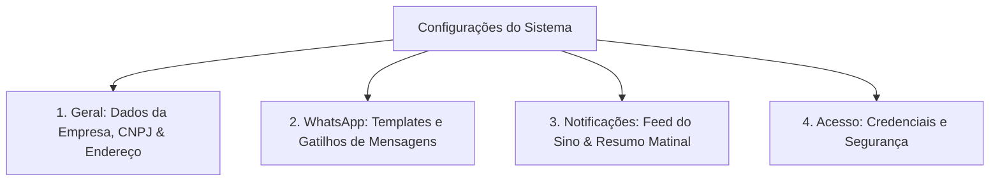

# Manual e Guia Completo: Configurações do Sistema Totten

> **Versão:** 2.0  
> **Público-alvo:** Administradores, Gestores de Clínicas e Atendimento  
> **Localização no Sistema:** Painel Administrativo -> Configurações (`/admin/settings`) e Central de Ajuda (`/admin/help/settings`)

---

## 1. Visão Geral e Estrutura

O módulo de **Configurações do Sistema** centraliza a identidade da sua clínica, as automações de comunicação via WhatsApp, a central de inteligência de notificações em tempo real e o controle de segurança e acesso.

A tela é organizada em **4 pilares estratégicos**:

---

## 2. Aba "Geral": Identidade e Dados da Clínica

Nesta seção, o gestor estabelece as informações oficiais do estabelecimento, que são replicadas nos cabeçalhos, comprovantes e no portal do cliente.

* **Integração com Consulta de CNPJ (BrasilAPI):**
  * Ao digitar o CNPJ da clínica e clicar na lupa de busca, o sistema preenche instantaneamente a Razão Social, Nome Fantasia, CEP, Logradouro, Bairro, Município e Estado.
  * Formatação inteligente em *Title Case* (padroniza maiúsculas/minúsculas mantendo siglas e preposições corretas).
* **Telefone e WhatsApp Comercial:**
  * Canais oficiais de contato que aparecem para os clientes no rodapé do portal de agendamento online.
* **Endereço Completo:**
  * Usado para geolocalização e orientações de rota enviadas aos pacientes.

---

## 3. Aba "WhatsApp": Automação e Mensagens Pré-formatadas

O Totten possibilita o envio ágil de mensagens via WhatsApp sem depender de disparadores piratas ou risco de banimento de número, utilizando integração direta via link nativo da API do WhatsApp.

### Modelos de Mensagens Disponíveis:
1. **Confirmação de Presença / Check-in:** Enviado quando a cliente realiza o check-in na recepção ou totem.
2. **Boas-vindas:** Enviado no primeiro cadastro de um novo cliente na clínica.
3. **Renovação de Pacote:** Disparado quando a cliente está na penúltima ou última sessão do seu pacote.
4. **Lembrete de Agendamento:** Mensagem enviada para recordar a cliente do dia e horário marcado.
5. **Confirmação Manual:** Usada na tela de *Confirmações Manuais* para clientes com agendamento pendente.
6. **Felicitações de Aniversário:** Modelo pré-configurado na tela de *Aniversariantes*.

### Variáveis Dinâmicas:
Você pode personalizar os textos inserindo tags que o sistema substitui automaticamente pelo dado real da cliente:
* `{nome}`: Primeiro nome do cliente.
* `{clinica}`: Nome oficial da clínica.
* `{data}` / `{horario}`: Data e hora do atendimento marcado.
* `{profissional}`: Nome do profissional que realizará o procedimento.
* `{servico}`: Nome do serviço ou sessão agendada.

---

## 4. Aba "Notificações": Central de Alertas e Resumo Matinal

Esta aba controla a inteligência de alertas proativos que mantém a equipe sempre informada sobre o que acontece na clínica em tempo real.

### A. Feed de Notificações em Tempo Real (Ícone do Sino no Topo)
Permite ligar ou desligar individualmente quais eventos geram notificações no sininho da barra superior:
* **Check-ins Realizados:** Avisa assim que uma cliente faz check-in no Totem ou na Recepção.
* **Solicitações de Agendamento:** Alerta imediato sobre novas marcações feitas no Portal Online.
* **Cancelamentos de Agendamento:** Notifica cancelamentos feitos por clientes ou pela equipe.
* **Última Sessão de Pacote:** Alerta quando a cliente conclui a última sessão do seu protocolo (gatilho de ouro para o time comercial oferecer renovação).
* **Estoque Baixo:** Notifica quando qualquer insumo atinge ou fica abaixo da quantidade mínima estipulada.

> **Dica Operacional:** O botão *"Marcar todas como lidas"* limpa o contador do sino com um único clique.

### B. Resumo Matinal (Daily Kickoff)
* **O que é:** Um banner de inteligência operacional exibido no topo do Dashboard logo pela manhã.
* **Informações apresentadas:**
  * Quantidade de atendimentos agendados para o dia.
  * Solicitações pendentes aguardando aprovação.
  * Aniversariantes do dia (com atalho para envio de mensagem com um toque).
* **Controle:** Pode ser desativado caso a clínica prefira um Dashboard mais limpo.

---

## 5. Aba "Acesso": Credenciais e Segurança

Garante a inviolabilidade das contas administrativas e a gestão de senhas do painel.

* **Troca de Senha Administrativa:**
  * Exige a digitação da senha atual para validação de segurança.
  * Validações de força (mínimo de 6 caracteres e confirmação idêntica).
* **Níveis de Acesso e Permissões:**
  * O Administrador (*Owner*) possui acesso irrestrito às configurações, financeiro e equipe.
  * Profissionais e colaboradores têm visualização restrita de acordo com as permissões concedidas na aba de *Profissionais*.

