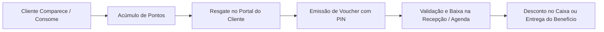
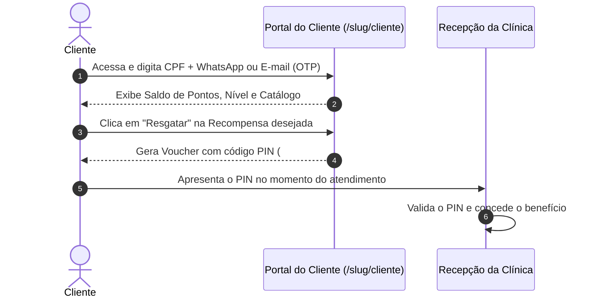

# Manual e Guia Completo: Programa de Fidelidade Totten

> **Versão:** 2.0  
> **Público-alvo:** Gestores de Clínicas, Recepcionistas, Atendentes e Desenvolvedores  
> **Localização no Sistema:** Painel Administrativo -> Fidelidade (`/admin/loyalty`) e Portal do Cliente (`/{slug}/cliente`)

---

## 1. Visão Geral e Propósito

O **Programa de Fidelidade do Totten** é um motor moderno de retenção, fidelização e incentivo à recorrência para clínicas e consultórios. 

Ele transforma atendimentos, pontualidade e consumo financeiro em uma moeda de relacionamento (pontos), que os clientes podem acumular e trocar por vantagens reais: **brindes, cortesias, descontos percentuais ou descontos em dinheiro**.

---

## 2. Como os Clientes Acumulam Pontos

O sistema oferece **três motores simultâneos e complementares** de acúmulo de pontos, configuráveis pelo gestor da clínica:

### A. Pontos por Check-in (Frequência e Presença)
* **Objetivo:** Estimular a cliente a comparecer presencialmente e registrar sua presença.
* **Gatilho:** Acionado automaticamente quando o status muda para `"Atendido"` na recepção, quando o cliente realiza check-in no **Totem de Autoatendimento**, na **Sala de Espera**, ou ao dar baixa em uma **sessão de pacote**.
* **Exemplo:** A cada visita na clínica, a cliente ganha **10 pontos**.

### B. Pontos por Agendamento (Incentivo Online)
* **Objetivo:** Estimular as clientes a utilizarem o link público de agendamento online, reduzindo a sobrecarga de ligações e mensagens no WhatsApp da recepção.
* **Gatilho:** Acionado no momento em que um agendamento é marcado como **"Realizado"** na agenda da clínica.
* **Exemplo:** Bônus de **5 pontos** adicionais por ter realizado o atendimento marcado.

### C. Pontos por Valor Gasto (Cashback em Pontos)
* **Objetivo:** Premiar clientes com base no ticket financeiro. Diferencia um cliente que fez uma limpeza simples de um cliente que comprou um protocolo estético ou cirúrgico de alto valor.
* **Gatilho:**
  1. **Agendamento Concluído:** Ao marcar o atendimento como "Realizado", o sistema calcula os pontos sobre o valor líquido pago (já descontando eventuais cupons e vouchers).
  2. **Venda de Pacotes / Protocolos:** Na compra de pacotes à vista (`pay_upfront`), o cliente acumula pontos na hora sobre o valor total do pacote (`PACKAGE_PURCHASE`).
* **Fórmula de Conversão:**
  $$\text{Pontos} = \left\lfloor \frac{\text{Valor Líquido Pago}}{\text{Razão (R\$)}} \right\rfloor \times \text{Multiplicador de Pontos}$$
* **Exemplo Prático:** Regra configurada: *A cada R$ 10,00 gastos = 1 ponto*.
  * Um procedimento de R$ 250,00 concede **25 pontos**.
  * Um protocolo de R$ 1.500,00 concede **150 pontos**.

### D. Ajustes Manuais e Bônus de Cortesia
* O gestor ou recepcionista pode, a qualquer momento na aba **Extrato**, creditar pontos de cortesia (ex: compensação de aniversário, atraso ou promoção relâmpago) ou realizar ajustes, preenchendo obrigatoriamente a justificativa.

---

## 3. Gestão e Configurações (Aba Configurações)

Na aba **Configurações** (`/admin/loyalty`), o gestor personaliza o comportamento do programa:

### 1. Status do Programa e Abrangência
* **Programa de Fidelidade Ativo:** Chave mestra liga/desliga. Se desativado, nenhum ponto é acumulado ou resgatado.
* **Abrangência Global:** Todos os clientes cadastrados acumulam pontos automaticamente.
* **Abrangência Específica:** Apenas clientes matriculados manualmente na aba *Visão Geral* acumulam pontos (ideal para programas VIP seletos).

### 2. Limite Máximo de Pontos (Teto de Segurança)
* Define o saldo máximo que um cliente pode acumular (ex: 500 ou 1.000 pontos).
* **Finalidade:** Impede o acúmulo desmedido de saldo sem que o cliente resgate recompensas, mantendo o programa sempre em rotação.

### 3. Integração com o Financeiro (Modo Manual vs. Automático)
* **Modo Automático:** Ideal para clínicas ágeis e atendimento solo. Quando a recepcionista insere o PIN do voucher no agendamento, o sistema calcula o abatimento (% ou R$) e abate o valor diretamente na fatura/receita financeira do agendamento.
* **Modo Manual:** Ideal para clínicas com controle rígido de caixa. O sistema dá baixa no voucher apenas como comprovante, cabendo ao operador aplicar o desconto manual no checkout ou na maquininha de cartão.

### 4. Expiração de Pontos por Inatividade (Proteção de Passivo)
* **O que é:** Vouchers de resgate possuem prazo, mas e os pontos acumulados? Se uma cliente não visitar a clínica por mais de 6 meses ou 1 ano, seus pontos podem expirar para evitar "passivos contábeis fantasmas".
* **Opções de Prazo:** `60 dias`, `90 dias`, `180 dias` (padrão) ou `365 dias`.
* **Como funciona:**
  * **Verificação Automática (Just-in-Time):** Ao consultar o saldo do cliente ou tentar resgatar, se ele excedeu o período sem nenhuma visita, o saldo zera na hora com auditoria.
  * **Botão "Executar Varredura Agora":** Permite à recepcionista ou gestor auditar e expirar todos os clientes inativos da organização em lote com um único clique.

---

## 4. Recompensas e Tipos de Vouchers

As recompensas são criadas no botão **"Nova Recompensa"** e possuem três modalidades:

| Tipo de Recompensa | Ícone / Badge | Exemplo Prático | Como o Sistema Processa |
| :--- | :--- | :--- | :--- |
| **Brinde / Cortesia (`GIFT`)** | Roxo (Presente) | *Drenagem Cortesia* ou *Kit Home Care* | Serviço 100% gratuito. No financeiro gera receita R$ 0,00 como quitado por voucher. |
| **Desconto Percentual (`PERCENTAGE`)** | Verde (Porcentagem) | *10% OFF em qualquer procedimento* | O sistema calcula 10% sobre o valor do serviço e subtrai o valor na cobrança. |
| **Desconto em Dinheiro (`FIXED_AMOUNT`)** | Azul (Cifrão) | *R$ 50,00 de Desconto* | Abate R$ 50,00 do valor total do procedimento no checkout. |

* **Validade do Voucher:** Prazo (em dias) que o cliente tem para utilizar o cupom após apertar no botão "Resgatar" (ex: 30 dias). Vouchers não utilizados dentro do prazo são marcados automaticamente como `EXPIRADO`.

---

## 5. Como o Cliente Usa (Área do Cliente)

O cliente não precisa baixar aplicativo na loja (App Store/Google Play); ele acessa diretamente pelo link da clínica no celular: `totten.app/{slug}/cliente`.

1. **Acesso Simplificado:** O cliente entra informando seu **CPF + WhatsApp** cadastrado ou via código de 6 dígitos enviado por **E-mail**.
2. **Visualização da Carteira:** Acompanha seus pontos em tempo real, nível atual (*Bronze*, *Prata* ou *Ouro*) e a barra de progresso para a próxima recompensa.
3. **Resgate com 1 Clique:** Na lista de recompensas disponíveis, o botão **"Resgatar"** fica habilitado se ele possuir pontos suficientes.
4. **Voucher Digital Seguro:** Ao resgatar, os pontos são debitados atomicamente e o sistema gera um cartão digital com o código PIN (ex: `#VCH-ABC123`), data de expiração e botão de cópia rápida.

---

## 6. Operação na Recepção (Validação e Baixa de Vouchers)

A recepção pode dar baixa no voucher de duas maneiras:

### Opção 1: Validação Direta no Agendamento (Recomendada)
1. Ao abrir o agendamento da cliente na **Agenda**, clique em **"Editar/Detalhes"** ou durante a realização do atendimento;
2. No campo **"Cupom / Voucher Fidelidade"**, digite o PIN fornecido pelo cliente (ex: `ABC123` ou `#VCH-ABC123`);
3. Clique em **"Validar"**: o sistema identifica o cliente, o tipo de desconto e recalcula o preço final na hora;
4. Ao salvar o agendamento como **"Realizado"**, o voucher é marcado como `UTILIZADO` e o valor líquido é lançado no financeiro automaticamente.

### Opção 2: Baixa Rápida na Aba "Visão Geral"
1. No menu principal, acesse **Fidelidade** -> **Visão Geral**;
2. No topo da tela, digite os 6 caracteres do PIN no campo **"Validar Voucher por PIN"** e clique em **"Buscar Voucher"**;
3. O card exibe o nome do cliente, benefício e status. Basta clicar em **"Dar Baixa no Voucher Agora"**.

---

## 7. Regras de Estorno e Proteção Operacional

O sistema conta com inteligência para desfazer operações sem causar prejuízos ou discrepâncias contábeis:

* **Desfazimento de Agendamento:** Se a recepcionista marcou um agendamento como "Realizado" por engano e depois voltou para "Confirmado" ou "Cancelado":
  * O voucher fidelidade utilizado é **automaticamente restaurado para `DISPONIVEL`** e desvinculado da transação.
  * Os pontos que o cliente havia ganhado por aquele agendamento são estornados com exatidão (`REVERT_APPOINTMENT`).
* **Exclusão de Agendamento:** Se um agendamento realizado for excluído, o voucher é recuperado para a carteira do cliente e os pontos concedidos são revertidos no livro-razão.
* **Cancelamento de Pacotes:** Se um pacote pago à vista for cancelado sem que nenhuma sessão tenha sido realizada, os pontos gerados na compra são estornados (`REVERT_PACKAGE`).

---

## 8. Livro-Razão e Extrato (Aba Extrato)

Para total transparência e auditoria fiscal/contábil, o Totten grava todas as movimentações na tabela de **Transações de Fidelidade** (`LoyaltyTransaction`):

| Tipo de Evento | Natureza | Descrição |
| :--- | :---: | :--- |
| `CHECK_IN` | Entrada (+) | Pontos por presença no totem, sala de espera ou sessão de pacote. |
| `APPOINTMENT` | Entrada (+) | Pontos por agendamento concluído (fixos e/ou por valor gasto). |
| `PACKAGE_PURCHASE` | Entrada (+) | Cashback em pontos por aquisição de pacote de serviços. |
| `MANUAL_BONUS` | Entrada (+) | Bônus concedido manualmente pela clínica com justificativa. |
| `REWARD_REDEEM` | Saída (-) | Débito de pontos pelo resgate de uma recompensa/voucher. |
| `POINTS_EXPIRED` | Saída (-) | Pontos zerados devido a inatividade prolongada do cliente. |
| `REVERT_APPOINTMENT` | Saída (-) | Estorno de pontos por cancelamento ou desfazimento de atendimento. |
| `REVERT_PACKAGE` | Saída (-) | Estorno de pontos por pacote cancelado sem uso. |
| `MANUAL_ADJUST` | Saída (-) | Ajuste negativo manual realizado pelo administrador. |

---

## 9. Perguntas Frequentes (FAQ)

### 1. Se a cliente tiver um agendamento e fizer check-in no totem, ela ganha pontos duas vezes?
O sistema possui trava de concorrência: se o cliente já ganhou pontos pelo check-in presencial daquela visita, o agendamento não pontua pontos fixos duplicados de presença, concedendo apenas os pontos pelo valor financeiro do serviço (se configurado).

### 2. O que acontece se o voucher expirar antes de o cliente usar?
O voucher muda de status para `EXPIRADO`. Ele não poderá ser utilizado na recepção e a mensagem informará a data em que o prazo se encerrou. Os pontos gastos no resgate não retornam automaticamente (estimulando o cliente a respeitar o prazo de resgate).

### 3. A clínica pode pontuar apenas por valor gasto (R$) e desativar pontos fixos?
Sim! Basta desativar as chaves de "Pontos por Check-in" e "Pontos por Agendamento" e manter ativa apenas a regra "Pontos por Valor Gasto".

### 4. Onde a clínica pode colocar o botão de ajuda para os funcionários?
No cabeçalho do módulo de Fidelidade, existe um botão de ajuda `(?)` que direciona a equipe para este manual ou para a base de conhecimento online com vídeos e passo a passo.

